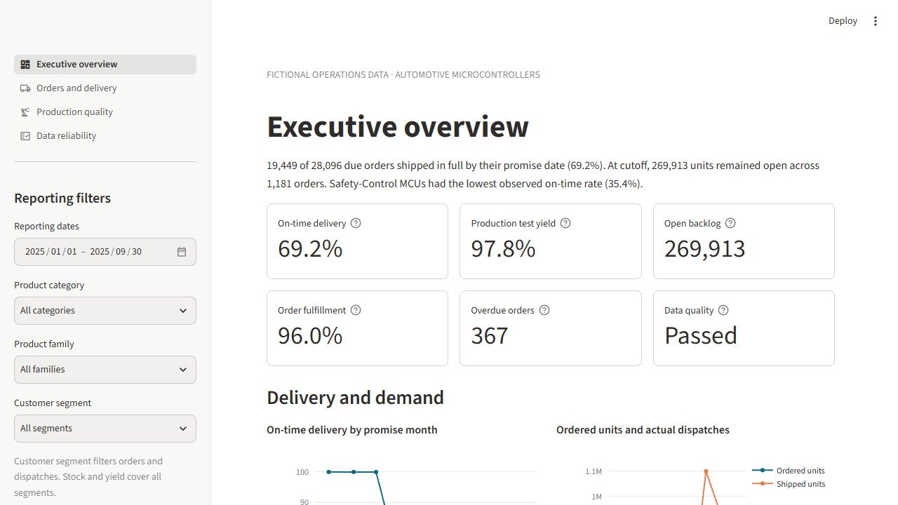

# Automotive MCU Operations Intelligence Platform

An end-to-end BI project for a fictional automotive microcontroller manufacturer. It tracks
delivery promises, open backlog, production test yield, inventory and the reliability of the
data behind those metrics. All records, operating targets and findings are simulated. The project
has no affiliation with Infineon Technologies.



## Run the demo

Open PowerShell in the repository with Python 3.12 available.

```powershell
python -m venv .venv
.\.venv\Scripts\Activate.ps1
python -m pip install -e ".[dev]"
python -m streamlit run app/streamlit_app.py
```

If PowerShell blocks activation, invoke `.\.venv\Scripts\python.exe` in place of `python`
after creating the environment. Without a loaded database the app builds a seeded DuckDB demo
in temporary storage. Open the localhost URL printed by Streamlit.

## Follow the operational workflow

1. In **Executive overview**, compare the delivery trend with monthly order and dispatch units.
2. Set the category to **Safety-Control MCUs** and open **Orders and delivery**. Compare missed
   promises and remaining units, then download the underlying orders.
3. On **Production quality**, compare weighted family yield and outcomes by traced lot group.
4. In **Data reliability**, click **Detect a duplicate order** and inspect the quarantined row.

The reference simulation includes nine months and 67,366 records. On-time delivery fell from
99.97% in March to 46.83% in May and recovered to 76.16% in September. See the
[simulated findings](docs/BUSINESS_INSIGHTS.md) and [three-minute demo](docs/INTERVIEW_DEMO.md).

## Replay through the last complete day

This writes a separate rolling DuckDB snapshot and weekly report through yesterday UTC.
Streamlit shows the simulation cutoff and the actual validation time separately.

```powershell
$env:MCU_BACKEND = 'duckdb'
$env:MCU_DATA_DIR = 'data/rolling'
python -m mcu_ops.reporting --live
python -m streamlit run app/streamlit_app.py
```

## Run each layer

From the project root with the environment active, stop any DuckDB dashboard before running
a separate process that reloads its local database.

```powershell
python -m mcu_ops.data_generation.generator
python -m mcu_ops.data_generation.generator --corrupt --output data/raw/faults
python -m mcu_ops.etl
python -m mcu_ops.etl --source data/raw/faults --mode quarantine
python -m mcu_ops.database
python -m mcu_ops.reporting --refresh
python -m mcu_ops.tableau
python -m pytest
python -m ruff check .
```

The standalone database and report commands default to DuckDB. See the
[deployment guide](docs/DEPLOYMENT.md) for Compose, PostgreSQL settings, GitHub and Streamlit
Community Cloud. To enable PostgreSQL tests locally, point `MCU_TEST_POSTGRES_URL` at a
disposable PostgreSQL database with permission to create test schemas. Unconfigured PostgreSQL
checks skip. GitHub CI provisions a temporary PostgreSQL service for them.
The [GitHub push guide](docs/GITHUB_PUSH.md) covers review, repository creation, push and hosted checks.

## Architecture and project map

```text
Fictional CSVs → Python ETL → DuckDB or PostgreSQL → shared SQL KPIs
                      ↓                                 ↓
              quality + quarantine          Streamlit / reports / Tableau
```

| Path | Purpose |
| --- | --- |
| `src/mcu_ops/data_generation` | Seeded NumPy and Faker simulation |
| `src/mcu_ops/etl.py`, `validation.py` | pandas CSV extraction, typed rules, quarantine and audit |
| `src/mcu_ops/sql`, `database.py`, `analytics.py` | SQLAlchemy loading, shared SQL and operational alerts |
| `app` | Four Streamlit pages with Plotly charts and CSV downloads |
| `src/mcu_ops/reporting.py`, `tableau.py` | Weekly Markdown monitoring and grain-specific BI exports |
| `tests`, `.github/workflows` | pytest, Ruff, integration checks and scheduled reporting |
| `docs` | Architecture, KPI definitions, evidence, deployment and interview material |

Learn the [data model](docs/ARCHITECTURE.md), [KPI definitions](docs/KPI_DEFINITIONS.md),
[SQL patterns](docs/SQL_WALKTHROUGH.md), [Tableau design](docs/TABLEAU_GUIDE.md) and
[build journal](docs/PROJECT_BUILD_JOURNAL.md). See [progress and verification](docs/PROGRESS.md)
for the status of local and hosted checks.

## Scope

Shipment dates serve as a proxy for delivery. The simulation models one SKU per order, omits
returns and cancellations, and offers fixed reference and rolling fictional replays. Quality comparisons
describe observed associations. A production extension could add carrier delivery events,
late-arriving data handling, incremental loads and data-contract monitoring.
