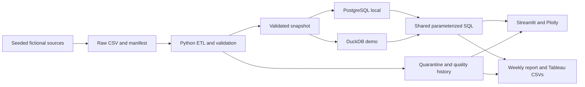
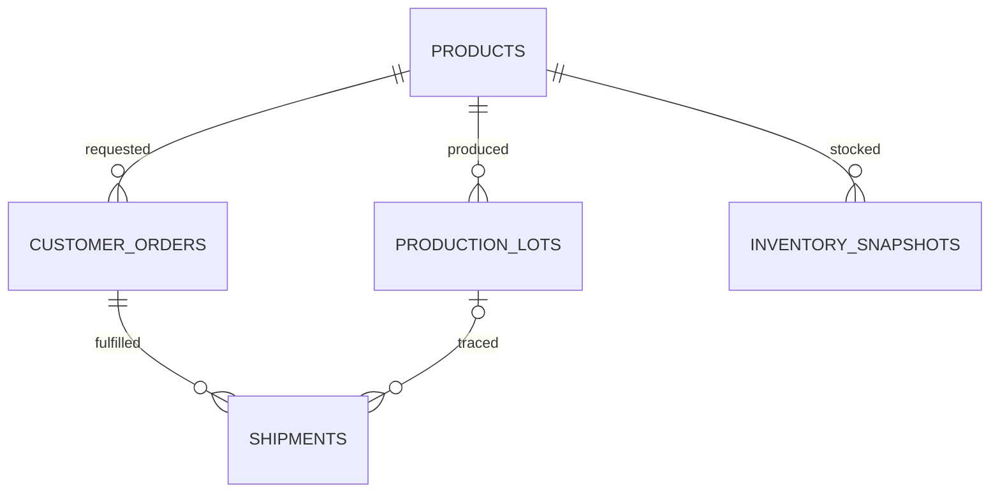

# Architecture

A primary key uniquely identifies a row. A foreign key points to the primary key of a related
row. Both links from shipments are many-to-one. Joining raw shipments directly to orders before
counting orders can multiply split orders, so the analytics layer first aggregates by order ID.

The dependency order is products, orders and lots, inventory, then shipments. Parent entities
are validated first. Database constraints provide a second layer for keys and row-local rules.
Cross-table chronology, product compatibility, cumulative quantities and freshness are enforced in ETL.
